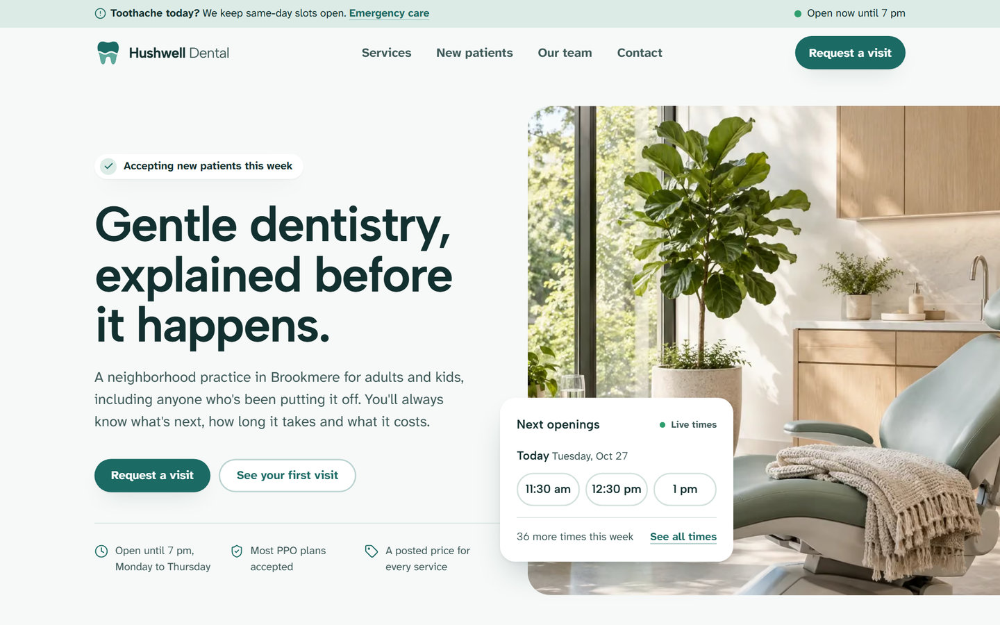
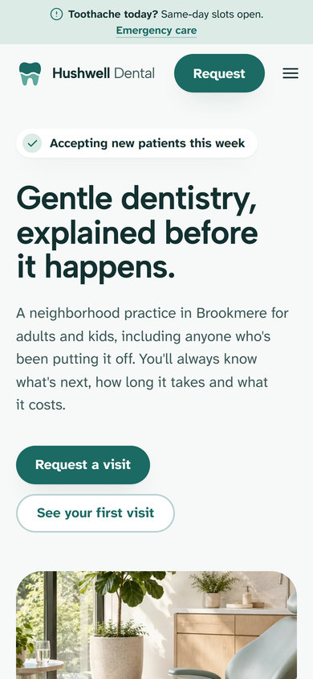

# Hushwell Dental

A brand and website for a fictional neighborhood dental practice, built with Next.js: calm, clear and made for nervous
patients.

**Concept project.** The brand is fictional. Hushwell Dental, its team, its reviews, its address and its phone number
are invented for this piece, and the forms do not send anything.

- **Try it:** [hushwell-dental.vercel.app](https://hushwell-dental.vercel.app)
- **Write-up:** [michaelshadpour.com/work/hushwell-dental](https://michaelshadpour.com/work/hushwell-dental)





## What's in it

- **Home:** a hero with a live "Next openings" card (bookable times worked out from the opening hours on the visitor's
  clock; there is no booking system behind it), the first visit explained minute by minute, every service with its
  posted price, the comfort menu, the team, reviews, insurance and the no-insurance membership, and how to find the
  practice.
- **Services:** an index with prices, and a page for each of the eight services: what happens step by step, "Does it
  hurt?", questions people ask, related care.
- **Request a visit:** pick a service, a day and an open time (or "I'm flexible"), your details and how you'll pay.
  Plain-language validation with an error summary, a live summary of the request, and a success screen that offers
  a calendar file (.ics) for the requested time. Nothing is sent anywhere: it's a front-end concept.
- **New patients, Our team, Contact and hours** (with a short message form), a 404 page, and a one-page brand guide at
  `/brand-guide`.
- **Motion:** words rise into place, photos open from a rounded window and drift gently as you scroll, the review
  count ticks up, the timeline lights up as you read it, reviews drift past in two rows, buttons ripple where you
  press, and the membership card leans toward the pointer. All of it switches off for visitors who prefer reduced
  motion.

## Run it

Needs Node.js 22.12 or newer.

```bash
npm install
npm run dev
```

Then open http://localhost:3000.

| Command | What it does |
|---|---|
| `npm run dev` | Development server |
| `npm run build` then `npm run start` | Production build and server |
| `npm run typecheck` | TypeScript check |
| `npm test` | Unit tests with Vitest: 60 cases on availability and open status, booking validation, phone numbers, the calendar file, content rules and color contrast |
| `npm run test:watch` | The same tests, re-run as files change |
| `npm run qa -- --base http://127.0.0.1:3000` | Every page at 390, 768, 1280 and 1440 px in a real browser: overflow, console errors, failed requests, accessibility (axe). Writes screenshots and a report to `.qa/` |
| `npm run e2e -- --base http://127.0.0.1:3000` | Six flows in a real browser: booking from the hero card, validation, a flexible request, the contact form, the phone menu, reduced motion |

`qa` and `e2e` run against a site that is already being served (for example `npm run build` then `npm run start`) and
need a Playwright browser: `npx playwright install chromium`.

## Layout

| Path | What is there |
|---|---|
| `src/app/` | The pages (App Router): home, services and one page per service, new patients, team, request a visit, contact, the brand guide and the 404 page, plus `globals.css` with every design token and the motion styles |
| `src/components/` | Components by area: `home`, `book`, `contact`, `visit`, `services`, `layout`, `motion`, `photo`, `brand` and shared `ui` |
| `src/content/` | The practice as data: site details and hours, services and prices, the team and reviews, the first visit, photo slots |
| `src/lib/` | Availability, booking validation and the calendar file, form helpers and fonts, with the unit tests beside them |
| `src/fonts/`, `public/` | The font files and the photos |
| `scripts/` | The two browser checks, `qa.ts` and `e2e.ts` |
| `docs/` | The two screenshots above |
| `DESIGN.md` | The design system: the idea, brand, color, type, shape and motion |

## Stack

Next.js 16 (App Router, fully static), React 19, TypeScript, Tailwind CSS 4, zod (mini) for validation, Lenis for
smooth scrolling, Vitest and Playwright for checks. Deploy-ready for Vercel (`vercel.json`, which also sends a
`noindex` header on every page).

## Photos

Drop a file named after its slot into `public/photos/` (`hero-room.webp`, `dr-raman.webp` and so on; the full list is
in `src/content/photos.ts`) and the next build uses it. Until a slot has a file, a drawn stand-in in the brand palette
fills it.

## Credits and license

- **Fonts:** Albert Sans (Copyright 2021 The Albert Sans Project Authors) and Atkinson Hyperlegible Next (Copyright
  2020-2024 The Atkinson Hyperlegible Next Project Authors), both under the SIL Open Font License 1.1. The files in
  `src/fonts/` and `public/fonts/` are the Latin variable fonts from the `@fontsource-variable` packages.
- **Photography:** original images made for this concept (no stock photos).
- **Logo, map and illustrations:** original SVG made for this project.
- **Icons:** the line icons in `src/components/ui/Icon.tsx` mix path data from [Lucide](https://lucide.dev) (ISC
  License) with icons drawn for this project, such as the tooth and the aligner. Lucide's license text is in
  [LICENSES/Lucide-ISC.txt](LICENSES/Lucide-ISC.txt).
- Design and build: [Michael Shadpour](https://michaelshadpour.com).
- The code is under the [MIT license](LICENSE). The fonts and the Lucide icon paths keep their own licenses.
